# miniVIC Games: 65C02 Arcade Collection

A collection of arcade games written in **65C02 assembly** for the **Boogs77-miniVIC**, a compact 8-bit computer built on the modular architecture of the [BO6502 System](https://github.com/Boogs77/BO6502_65C02-based_modular_computer). Every title uses the **TMS9918A** video processor for tile and sprite graphics and two **AY-3-8910** sound chips for stereo music and effects.

> 🖥️ The **miniVIC** hardware (schematic, PCB, memory map, firmware) is presented in its own repository: [miniVIC_65c02](https://github.com/Boogs77/miniVIC_65c02). This repository contains only the game software.

---

## 🎮 Games

| File | Game | Players | Description |
| :--- | :--- | :---: | :--- |
| `tank.asm` | **Tank vs Tank** | 1–2 | Two tanks on a green battlefield: rotate, move and shoot. First to reach the winning score wins. Play against a friend or against the computer. |
| `1vs1.asm` | **1 vs 1 Basketball** | 1–2 | One-on-one basketball with shots, jumps, steals and blocks. 2 and 3 point shots, first to 21 wins. Play against a friend or against the computer. |
| `centipede.asm` | **Centipede** | 1 | The classic arcade: shoot the centipede through the mushroom field, watch out for the flea and the spider. Infinite levels. |
| `missile_command.asm` | **Missile Command** | 1–2 | Defend 6 cities from incoming missiles using 3 bases. The second player can join at any time. Full bitmap graphics. |
| `lunar_lander.asm` | **Lunar Lander** | 1 | Land the module softly on the moon pads: smaller pads pay more, plus a leftover fuel bonus. 6 moon maps, 3 landers. Full bitmap graphics. |
| `the_warriors.asm` | **The Warriors** | 1–2 | Street Fighter style fighting game: 5 warriors, 6 stages, punch, kick, block and special move. Best of 3 rounds. Play against a friend or against the computer. |
| `breakout.asm` | **Breakout** | 1–2 | Atari 1976: 8 rows of bricks in four colours, the ball speeds up and the paddle shrinks when you break through. Two walls, players take turns. |
| `asteroids.asm` | **Asteroids** | 1–2 | Atari 1979: vector-style asteroids that split in three sizes, large and small saucers, hyperspace and the famous heartbeat. Players take turns. |
| `space_invaders.asm` | **Space Invaders** | 1–2 | Taito 1978: 55 invaders that march one at a time, shields that crumble pixel by pixel, three kinds of bombs, mystery saucer and the four-note march. Colour bands of the cabinet overlay. |
| `warlords.asm` | **Warlords** | 1–2 | Atari 1980: four castles, shields on an L-shaped track, catch and throw the fireball. 1 or 2 players against the computer castles; first to 3 rounds wins. |
| `defender.asm` | **Defender** | 1 | Williams 1981: a scrolling planet that wraps around, scanner, landers kidnapping humanoids, mutants, bombers, pods, swarmers and baiters; laser, smart bombs, hyperspace. |
| `radar_scope.asm` | **Radar Scope** | 1–2 | Nintendo 1980: a field in perspective with a blue sky and a curved radar grid, 48 Gamma Raiders that hover forward, dive and drop decoys, and a damage meter that slows down the laser. Players take turns. |
| `space_firebird.asm` | **Space Firebird** | 1–2 | Nintendo 1980: a scrolling starfield, Firebirds that arrive as comets, loop the loop and turn into Gulls, Eagles and Emperors; eagle bombs that burst into shrapnel, a once-per-ship shielded warp and a PERFECT bonus for 50 birds out of 50. Players take turns. |
| `moon_cresta.asm` | **Moon Cresta** | 1–2 | Nichibutsu 1980: a three-stage rocket where every stage is a life, timed docking with retro rockets for a bonus and more firepower, and waves of Cold Eyes that split in two, Super Flies, Four-Ds, meteors and Atomic Piles, with a start tune. Players take turns. |
| `stargate.asm` | **Stargate** | 1–2 | Williams 1981, the sequel to Defender: the Stargate that jumps to the humanoid in danger (or warps 3 waves ahead with 4 humanoids on board), Inviso cloaking, several humanoids carried at once, Firebombers, Yllabian Space Guppies, Dynamos, Phreds and Big Reds, plus the Yllabian Dogfight and Firebomber Showdown waves. Players take turns. |
| `gravitar.asm` | **Gravitar** | 1–2 | Atari 1982: fly from planet to planet of 3 solar systems while the death star pulls the ship in, blast the bunkers, pull up fuel cells with the tractor beam, raise the shield, fight the alien saucer in deep space and blow up the reactor of the red planet before the clock runs out. Then the universe changes: negative gravity, invisible landscape, both. Players take turns. |
| `quantum.asm` | **Quantum** | 1–2 | Atari 1982: guide your probe with inertia like a trackball to draw loops around particles and destroy them. Multiple particles in one loop multiply the score. Progressively harder waves with nuclei that release positrons, splitters that divide and pulsars that hunt. Players take turns. |
| `joust.asm` | **Joust** | 1–2 | Williams 1982: a knight on a flying ostrich, and a second one on a stork with both players at the same time. Flap to climb: the higher lance wins. Bounders, Hunters and Shadow Lords leave eggs to pick up before they hatch, the pterodactyl must be hit in the beak, the hand of the troll grabs who flies low over the lava and the bridge burns away. Survival, Team, Gladiator and Egg waves. |
| `exerion.asm` | **Exerion** | 1–2 | Jaleco 1983: a fighter with inertia, free to fly over the whole screen: black sky above, below the ground rushes towards you in pseudo-3D bands, with the hills on the horizon moving in parallax. Formations of crosses, egg-throwing birds, jets and UFOs come from the horizon, growing as they approach, then close in a ring around the fighter, turn round it and dive at it. Unlimited dual shot, rapid single shot that uses charges (won back by hitting with the dual shot), formation bonus doubling up to 10000 and a challenging stage after every stage. Players take turns. |
| `bubbles.asm` | **Bubbles** | 1–2 | Williams 1982: a soap bubble cleans a kitchen sink, sliding with inertia and growing as it eats crumbs, ants and grease (double near the drain). With eyes and a mouth it bounces sponges and brushes away, even down the drain; razor blades always pop it. Take the broom from the cleaning lady's bristles to swat the roaches that crawl out of the red-flashing drain, then slip into the green drain for a bonus of 1000 times your size; eat the last dirt first and the faucet floods the sink: on to the next level, without the bonus. 99 levels, players take turns. |
| `times_tables.asm` | **Times Tables** | 1–2 | An original educational game (screen texts in Italian, *TABELLINE*): the times tables from 1 to 10, one question and four answers in a cross, chosen with one push of the joystick. Practice with help, a challenge with a red two-digit countdown like a basketball scoreboard, and a duel against a friend or the computer. Wrong answers show the repeated sum and come back more often; a colour table shows what has been learnt, and every table has a monster to catch and evolve. |
| `robert.asm` | **Robert** | 1–2 | An original isometric cube-hopping game: Robert, a little robot on a pogo stick, hops diagonally across boards of cubes floating in the void and paints every top in the goal colour, without hopping off the edge. Four boards (diamond, hourglass, ring, twin towers) and four colour rules (one hop, two hops, every hop switches, a third hop undoes). Blot the ink drop chases him, Roller wipes the paint, Spark runs round the edge and Ghost Robert repeats his hops three seconds later. Gold cubes throw him far away, the bucket paints around, the star squashes the Blot; one long jump per round. Players take turns. |
| `cloud_raider.asm` | **Cloud Raider** | 1–2 | An original isometric shooter: a ship flies over fortresses built on islands floating among the clouds, while the world scrolls diagonally and the floor glides by. Change altitude with the joystick (the shadow and the gauge tell how high you are) to slip through the gaps of high walls, hop over low walls and dive under energy fences; fire at mines and fighters at their own altitude, drop bombs on towers, radars and fuel depots to keep the energy up. At the end of every fortress the Guardian waits: a core behind four turning shields. Four fortresses, then again faster. Players take turns. |
| `crystal_gardens.asm` | **Crystal Gardens** | 1–2 | An original isometric maze game: a hedgehog walks freely over the terraces of gardens floating in the night sky, climbing ramps and jumping up and down steps, and picks up every crystal seed. Magpies swoop down to steal the seeds (touch them to scare them away), a mole leaves its hole to chase you, pine cones roll down the ramps (jump over them) and when the time bar runs out the owl comes. The golden acorn rolls the hedgehog into a spiky ball that beats moles and pine cones. Sixteen gardens in four worlds, each with its own tune: the orchard, the dunes, the slippery ice house and the night garden with its portals; then again faster. Players take turns. |
| `special_forces.asm` | **Special Forces** | 1–2 | An original side-scrolling action game: a commando crosses an enemy camp from left to right, running on the ground and on two floors of steel walkways joined by ladders. Knife the sentries, kneel under the riflemen's bullets, jump over barbed wire and mines, and take a machine gun, a mortar or a timed charge from the couriers. Sappers jump from floor to floor, shield men can only be beaten from above or from behind, machine-gun nests take three hits. Four sectors (perimeter, barracks, fuel depot and command bunker, from day to night): at the end of each one plant the charges on the targets and get the objective blown up. Two gates per sector, players take turns. |
| `core_runner.asm` | **Core Runner** | 1–2 | An original space run and platform game in two parts. First the approach: fly the shuttle over a star field, shoot rocks, fighters, gunships and mines, then slip into the docking bay of the station as it slides up and down the hull. Then the station: three rooms of floors, ladders, conveyors, lifts, electric arcs, presses and crumbling floors, guarded by drones, jumpers, sparks, turrets and spiders. Reach the energy core, overload it and run back to the shuttle before the countdown ends, while the oxygen keeps going down. The stunner stops a drone for a few seconds. Eight stations, players take turns. |
| `deep_space_miner.asm` | **Deep Space Miner** | 1–2 | An original space mining shooter in a sector of 8 × 8 screens that wraps round, with a radar at the top. Fly the drill ship with inertia, shoot the rocks to break crystals out of them and pick them up: every crystal is a seismic charge. Drones steal the crystals and carry them to the Colossus, a giant mechanical spider built piece by piece; with all 20 pieces it wakes up and hunts you, while fighters keep close and shoot. Drop charges near it: they find it by themselves and knock its pieces off one by one. Players take turns. |
| `dune_ranger.asm` | **Dune Ranger** | 1–2 | An original side-scrolling rover game on a red desert planet. Drive from outpost to outpost while the mesas, the dunes and the track scroll at different speeds: RIGHT goes faster, LEFT slower. Jump the craters, shoot the rocks ahead and the drones overhead (one button fires forward and up together), watch out for spring mines, sand worms rising out of the track and sandstorms chasing you from behind. Eight legs by day with a time bonus at every outpost, then the night run. Players take turns. |
| `sky_tug.asm` | **Sky Tug** | 1–2 | An original vertical-scrolling shooter: a space tug flies over a planet of islands, a sunken city, a crystal forest and an enemy base while the ground scrolls smoothly 2 pixels at a time. Air waves (fighters in V, spiralling hawks, hovering drones, bombers) and ground targets (tanks, turrets, boats, missile launchers) attack. Shoot the depots open to find the four numbered modules of the tug and dock them: each one adds a gun (front, left, right, rear), a hit costs the last one. Button 2 sends 2–3 modules into a firing formation around the tug, with all four it becomes the full ship for 15 seconds. A flying fortress with two cannons guards the end of every area; checkpoints along the way. Players take turns. |
| `super_carlo.asm` | **Super Carlo** | 1–2 | An original single-screen platform game in a shipyard where a cruise ship is being built. Carlo the welder (and his mate Fabio, two players at the same time) clears the decks of rats, riveter robots and gulls that come in through the hatches: jump under a steel deck to bump it and turn over whoever walks on it, then kick them into the sea before they get up again, faster. Riveters take two bumps, gulls can only be bumped when they land, welding sparks bounce around, bolts fall from the crane and oil slicks make the decks slippery. The ship siren turns everybody over (three uses). Six decks and two bonus rounds with the launch bottles, then the ship is launched and a faster one begins. |
| `ghost_ghust.asm` | **Ghost & Ghust** | 1–2 | An original single-screen platform game: two kind little ghosts, Ghost and Ghust (two players at the same time), take back their abandoned villa room by room, from the cellar up to the tower, 30 rooms. Shoot a round cloud at a creature to shut it inside, then touch the cloud to pop it: the creature falls as a sweet, and clouds that touch pop together for 1000, 2000, 4000 and 8000 points. Bats, spiders, hopping pumpkins, candles that throw flames and armours that first lose their helmet; a creature left too long in its cloud gets out angry. Collect G-H-O-S-T for an extra life, the lantern and the bell help, and if you dawdle the sun rises and its ray hunts you. |
| `wormer.asm` | **Wormer** | 1–2 | An original maze game with a growing body: a caterpillar that never stops crawls through the tunnels of a giant apple, slice by slice down to the core, 24 slices and then again faster. Every seed makes it one piece longer and it must never bite its own tail. The joystick books the next turn at the first crossing; at a bend it turns by itself. The gold seed is worth five times, the leaf makes it four pieces shorter and the honey stops the clock; when time runs out the apple rots. From slice 5 the worms of the apple come out of their holes. Players take turns. |
| `sky_squirrel.asm` | **Sky Squirrel** | 1–2 | An original jump and glide platform game: Pip, a flying squirrel, gathers the 24 acorns a storm scattered on every stage, 15 stages in five places (an oak wood, a waterfall, an old mill, the city roofs, the snow peaks), then the world again, faster. Hold the button to jump higher, press it again in the air to glide down slowly. One acorn at a time shines: take them in that order for the chain bonus. Owls, wasps, hedgehogs, crows and pine cones come in from the top; the gold acorn turns them into nuts for a while, and falling leaves raise the multiplier or give a life. Players take turns. |
| `room.asm` | **Room** | 1 | An original first-person maze shooter: a mining base on a moon has gone mad and a technician goes down level by level to the reactor, 8 levels and then the base again, faster. Step from cell to cell and turn by quarters while the corridors are drawn in perspective; strafe, switch weapons and look at the map of the places already seen with button 2. Guard robots, tunnel spiders, drones that shoot from afar and the keeper of the reactor; a pulse pistol, a rifle and a plasma cannon that hits every foe in line. Red, blue and yellow cards open the doors, the lift ends the level; energy cells and medical kits lie in the dead ends. |
| `zork1_kb.asm` | **Zork I (keyboard)** | 1 | *The Great Underground Empire*: the Infocom text adventure, the original story file on our own **miniVIC Z-Machine**. Explore the white house, the forest and the dungeons below, collect the 19 treasures for the trophy case and outwit the thief and the troll, up to 350 points. Type the commands on the PS/2 keyboard. |
| `zork1_joy.asm` | **Zork I (joystick)** | 1 | The same story, with the sentences made of words chosen from menus with the joystick. |
| `zork2_kb.asm` | **Zork II (keyboard)** | 1 | *The Wizard of Frobozz*: the second Infocom story, on the miniVIC Z-Machine. The barrow leads deeper into the empire, where the Wizard of Frobozz plays his tricks while you look for his treasures, past the dragon and the princess. Type the commands on the PS/2 keyboard. |
| `zork2_joy.asm` | **Zork II (joystick)** | 1 | The same story, with the sentences made of words chosen from menus with the joystick. |
| `zork3_kb.asm` | **Zork III (keyboard)** | 1 | *The Dungeon Master*: the third Infocom story, on the miniVIC Z-Machine. At the bottom of the endless stair the Dungeon Master puts you to the test, between the Land of Shadow, the royal puzzle and the time machine. Type the commands on the PS/2 keyboard. |
| `zork3_joy.asm` | **Zork III (joystick)** | 1 | The same story, with the sentences made of words chosen from menus with the joystick. |
| `robo_vac.asm` | **Robo Vac** | 1–2 | An original maze-chase game: a little robot vacuum cleans the house room by room, from the kitchen to the attic, 8 rooms and then the house again, faster. Four dust bunnies hunt it: Fluff follows it, Lint cuts it off, Fuzz dashes when it sees it, Grit guards the wall sockets. Every socket gives a few seconds of turbo, when the bunnies turn pale and the robot sucks them up for 200, 400, 800 and 1600 points; a sucked-up bunny flies home as a pair of eyes and rests a few seconds in the laundry basket before it comes out again. Lost things show up under the laundry basket, the passage under the doors leads to the other side, and from the bedroom the cat of the house sits in a corridor now and then. Players take turns. |
| `little_6502_guy.asm` | **Little 6502 Guy** | 1 | An original life-sim toy: Six, a tiny technician, lives in a three-floor house built on the 6502 chip of your miniVIC, with Byte, his black cat. He eats, drinks, takes baths, sleeps, reads, plays piano records and dances, rides the exercise bike, tinkers in the workshop and types letters to you, all on his own and by the clock of the house. Bring food and water, fill Byte's bowl, send gifts, knock on the glass, ask him (nicely: please helps) to do something, play HI-LO BITS with him (guess if the next 8-bit number is higher or lower, lit up in binary) and read his letters. In a new house Six first knocks at the door and looks around every room before he decides to move in, and every new house gives him a different character. Nobody wins or loses: the house is saved on the SD and goes on the next day. |
| `hedge_hop.asm` | **Hedge Hop** | 1–2 | An original crossing game: Spike the hedgehog goes home to the hedge. First a country road with a milk truck, motorbikes, cars and tractors, then a stream crossed on floating logs and lily pads, some of which go under now and then. One hop a lane, 30 seconds a hedgehog, five holes in the hedge to fill. A beetle in a hole and a little hedgehog waiting on a log are worth more; from level 2 a fox trots on the bank, from level 3 a heron lands in the hedge, from level 4 a snake walks on the logs. Morning, afternoon, sunset and night, then morning again, faster. Players take turns. |
| `mole_hole.asm` | **Mole Hole** | 1–2 | An original digging game: Mole the mole digs tunnels under a vegetable garden, through soil, clay, gravel and rock. Grubs follow the tunnels and now and then creep through the earth, the mole cricket digs new tunnels of its own. Mole's ice ray freezes a bug a little more at every hit: the third time it becomes a block of ice and breaks, worth more the deeper it is. Potatoes and stones fall when the earth below them is gone and squash whoever is under them; after two of them a vegetable shows in the middle. The last bug left runs to the surface. Eight gardens, then again, faster. Players take turns, each with his own garden. |
| `lighthouse_keeper.asm` | **Lighthouse Keeper** | 1–2 | An original climbing game: on a stormy night Gus the keeper climbs back to relight his lighthouse, while Squawk the seagull throws coconuts that roll down the sloping planks and now and then down a ladder. Jump over them, or take a broom and sweep them away for a few seconds. Four screens: the pier (a blue coconut in the lobster pot lets out a crab), the cliff (lifts made of waves), the stairs (starfish hopping down) and the lantern, where Gus shuts the eight open windows to light the lamp again. A bonus counts down on every screen. Players take turns. |
| `paint_duel.asm` | **Paint Duel** | 1–2 | An original paint-trail duel: two painters push their rollers over a polished floor, and every roller leaves a stripe of wet paint behind. The rollers never stop; the joystick turns them left or right. Roll into wet paint (yours or the other's), the skirting board, a paint can or the table and the round is lost. The button gives a short sprint, three a round. Four rooms in turn, a little faster every two rounds; the first to five rounds wins. One player against the CPU or two players at the same time; the record is the most wins in a row against the CPU. |
| `lix.asm` | **Lix** | 1–2 | An original territory game: Flora the gardener runs along the hedges of a wild lawn and plants new hedge in the tall grass. When the new hedge meets the old one, the part without the tornado becomes a flower bed. Hold button 1 for a fast hedge, button 2 for a slow one that is worth double. The tornado pulls up an unfinished hedge, the mad shears chase Flora along the hedges, and if she stands still a caterpillar eats the new hedge up to her; when the timer runs out the shears turn red and follow the new hedge too. Tidy 75% of the lawn to go on; four seasons in turn, two tornadoes from lawn 3 (split them for a bonus). Players take turns. |
| `cheese_chase.asm` | **Cheese Chase** | 1–2 | An original digging puzzle platformer: at night Squeak the mouse steals the cheese wheels of a dairy, on floors of wooden planks and stone joined by ladders and milk pipes to hang on. Button 1 gnaws a hole in the planks on the left, button 2 on the right: the hole closes again after five seconds. A cat that falls into a hole is stuck for a while and drops the cheese it carries; a hole that closes on a cat sends it back to the top, one that closes on Squeak takes a life. Take every wheel and a ladder shows up to the top. 16 levels, then again with faster cats; 5 lives, one more at every level done. Hold both buttons to give up a level. Players take turns. |
| `haunted_keep.asm` | **Haunted Keep** | 1–2 | An original maze shooter: Sir Bram the knight walks the 64 halls of a haunted castle, seen from above. Hold a button and push a direction to shoot an arrow in one of eight directions. The suits of armor walk towards him and break on the walls, on each other and under the arrows; from the third hall on they throw axes, more often and faster hall after hall. The walls are cursed: touching them takes a life. Linger too long and a ghost floats in through the walls; an arrow sends it away for a while. Out of a door to the next hall, the door behind is barred. A bonus for every hall cleared; 3 lives, one more every 5000 points. Players take turns. |
| `pastry_panic.asm` | **Pastry Panic** | 1–2 | An original platform game: Chef Pip builds four cakes in a pastry shop of shelves and ladders. Walk over a cake layer (sponge, cream, chocolate, icing) from end to end and it falls to the next shelf; a layer falling on another one pushes it down, and under the last shelf the layers pile up on the plates. Rebel strawberries, bananas and lemons chase him on the shelves and the ladders: a falling layer squashes them, or takes them down for more points. The button shakes icing sugar that stuns the fruit: 5 doses a level, and a cherry now and then gives one more. 6 layouts, then again with more and faster fruit; 3 lives, one more at 10000 points. Players take turns, every one with his own cakes. |

Each source file starts with a header describing controls, rules and technical notes.

> ℹ️ These games are non-commercial fan-made tributes to the original arcade games: see the **Disclaimer** at the end of this page.

### 🏆 Records on the SD card

Every game keeps its **8 best scores**, each signed with **3 initials**, on the SD card:

* after the game over, a player whose score enters the table signs it: UP / DOWN change the letter, LEFT / RIGHT move, a button goes on (after 30 seconds the initials are confirmed by themselves);
* the title screen shows the table every few seconds, and the best score is the HI of the game;
* in the one-against-one games (Tank vs Tank, 1 vs 1 Basketball, Warlords, The Warriors) the table counts the **wins in a row against the computer**: after every win the run is signed again and its row moves up;
* Times Tables keeps the scores of the challenge, with the screens in Italian and the table under **RECORD** in the menu;
* the records are written with the **BIOS KEYB/SD** in a save area after the first 16 MB of the card, which the SD tools never overwrite; with the older BIOS the table stays in RAM until the power goes off;
* the web emulator keeps the save area in the browser and can export or import it as a `.json` file; `saves.py` of [bo6502-SDbuilder](https://github.com/Boogs77/bo6502-SDbuilder) reads and writes the same area on a real card.

### 📜 miniVIC Z-Machine (Zork I, II, III)

The three Zork programs run the **original Infocom story files** (Z-machine version 3) on the **miniVIC Z-Machine**, a new interpreter written for the miniVIC in 65C02 assembly from the *Z-Machine Standards Document 1.1*:

* the story is read from the SD card (sectors from 20480, only in the full SD of [bo6502-SDbuilder](https://github.com/Boogs77/bo6502-SDbuilder)): its dynamic memory stays in RAM, the rest is paged in 512-byte frames of RAM and of the free VRAM;
* 40 × 24 text mode with the status line (room, score, moves), word wrapping and `[MORE]`;
* **keyboard version** (PS/2 keyboard of the BIOS KEYB/SD): type the commands, BACKSPACE / ESC to correct, UP brings the last command back;
* **joystick version**: the sentence is made of words chosen from lists at the bottom of the screen. UP / DOWN choose the list (GO, VERBS, HERE = the nouns on the screen, WORDS, ALL = the whole dictionary, GAME = look, inventory, save ...), LEFT / RIGHT the word, button 1 adds it (a direction or a game command alone is sent at once), button 2 sends the sentence; hold button 2 with UP to take the last word away, DOWN to clear, LEFT / RIGHT to jump to the previous / next letter. Digits join into numbers;
* **SAVE** and **RESTORE** keep three saved games per story on the SD card (save zones 35-37 and 44-49), shared by the two versions: they list the three places with score and moves and ask which one (keys 1-3, or UP / DOWN and button 1; button 2 cancels); `$VERIFY` checks the story on the card;
* the story files come from [historicalsource/zork1](https://github.com/historicalsource/zork1), [zork2](https://github.com/historicalsource/zork2) and [zork3](https://github.com/historicalsource/zork3), released under the **MIT License** (c) 2025 Microsoft; they are written on the SD card unchanged, together with their licence.

---

## 🧠 Hardware Requirements

The games run on the miniVIC and rely on the following BO6502 modules:

### 📺 Video (TMS9918A)
* **Mode:** Graphics II (256x192, 32 sprites), bitmap mode for Missile Command.
* **Addressing:** VDP register port at **$B001**.
* **Reference:** [BO6502 VDU](https://github.com/Boogs77/BO6502_65C02-based_modular_computer/tree/main/BO6502%20VDU).

### 🔊 Audio (2 x AY-3-8910)
* **Right channel:** latch **$D380**, write **$D381**.
* **Left channel:** latch **$D384**, write **$D385**.
* **Reference:** [BO6502 AUDIO](https://github.com/Boogs77/BO6502_65C02-based_modular_computer/tree/main/BO6502%20AUDIO).

### 🕹️ Joysticks (W65C22 VIA)
* **Player 1:** PORTA at **$D581**.
* **Player 2:** PORTB at **$D580**.
* **Bits:** UP, DOWN, LEFT, RIGHT, button 1 (bit4), button 2 (bit5).
* **Reference:** [BO6502 JOYSTICK](https://github.com/Boogs77/BO6502_65C02-based_modular_computer/tree/main/BO6502%20JOYSTICK).

---

## 💻 Program Structure

All games share the same layout:
* **Load address:** programs are assembled at **$1000**.
* **NMI trampoline:** at **$0FD0**, called by the BIOS `NMI_HANDLER` with `JSR $0FD0` on every VDP vertical blank (60 Hz).
* **Frame update:** the NMI copies the sprite attribute table (SAT) buffer to the VDP and runs the sound engine, while the main loop handles game logic.
* **Graphics data:** screens, patterns and sprites are stored as generated tables at the bottom of each file.

---

## 🛠️ Build

The games are assembled with **vasm6502_oldstyle** (`-Fbin -dotdir -c02`). Ready-to-load binaries are in the [`bin`](bin) folder; each one starts at **$0FD0** (NMI trampoline) followed by the program at **$1000**.

To rebuild them:
1. Write the full path of `vasm6502_oldstyle.exe` in a file named `vasm.path` (or set the `VASM` environment variable).
2. Run `build.bat` to assemble all games, or `build.bat tank.asm` for a single one. In VS Code, press **Ctrl+Shift+B** to build the open file.

The script assembles every file into `bin/`, optionally copies the sources and binaries to the local folder written in `copy.path`, runs each game in the emulator to update its screenshots, then commits and pushes the updated binaries and screenshots. Use `build.ps1 -NoPublish` to build without publishing.

### 🖥️ Emulator & Screenshots
The [`tools`](tools) folder contains a small **miniVIC emulator** written in Node.js (no dependencies): W65C02S CPU, TMS9918A video with sprites, VDP interrupt on NMI and the two joysticks. It has no audio, but it can record what the games write to the two AY chips. With the BIOS KEYB/SD option (the default) it also emulates the PS/2 keyboard and the SD sector routines at `$FD18`/`$FD1B`/`$FD1E` on the save area of the card (sectors from 16 MB), so the games that keep their records on the SD can be tested; `bios: 'old'` leaves them out, like the BIOS 24.10.26.
* `node tools/screenshots.js` runs every game and saves its screenshots in [`screenshots`](screenshots).
* `tools/screenshots.json` defines, for each game, the input sequence (wait, button presses, random play) and when to take each picture.
* `node tools/aywav.js tank` runs a game, records its AY writes and renders them to a stereo WAV in `sounds/` (left AY = left channel), to listen to the music and sound effects without the hardware.

---

## 🖼️ Screenshots

Captured with the miniVIC emulator in [`tools`](tools): title screen and gameplay.

### Tank vs Tank

  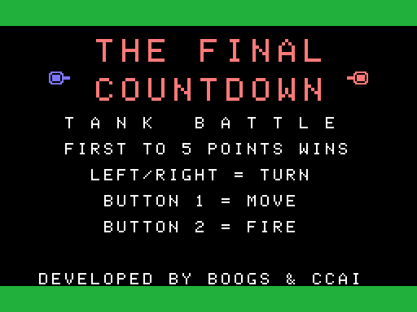
  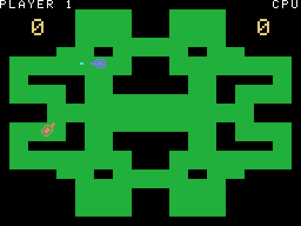

### 1 vs 1 Basketball

  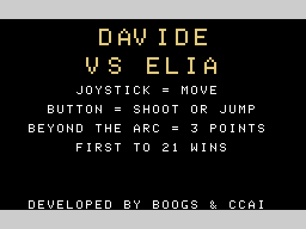
  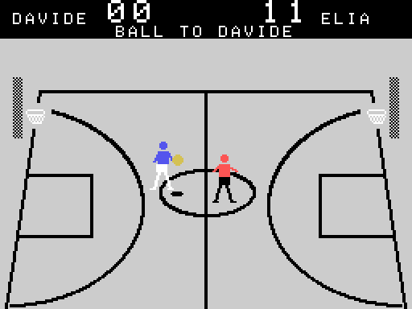

### Centipede

  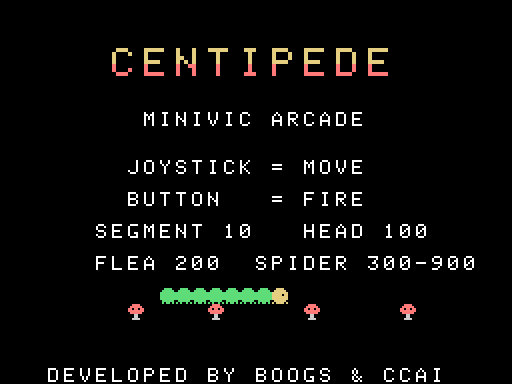
  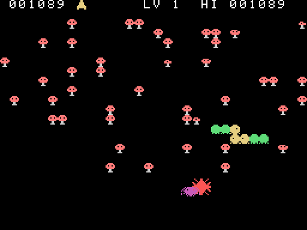

### Missile Command

  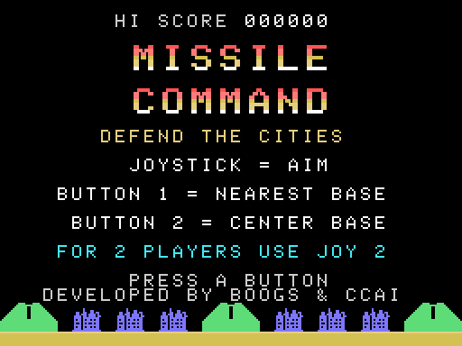
  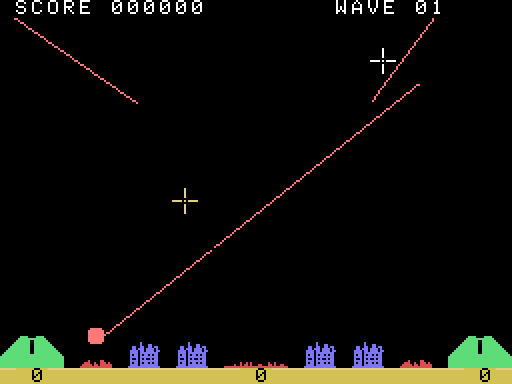

### Lunar Lander

  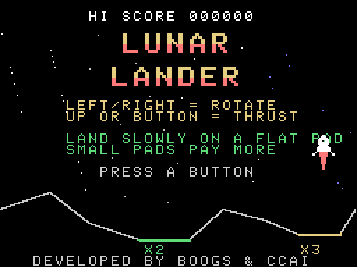
  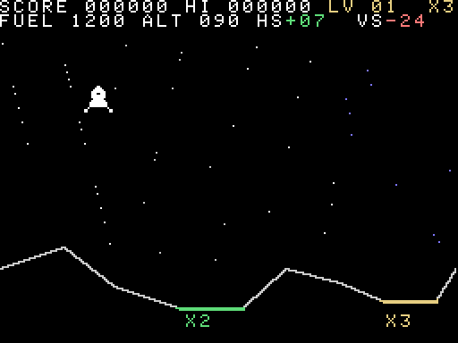

### The Warriors

  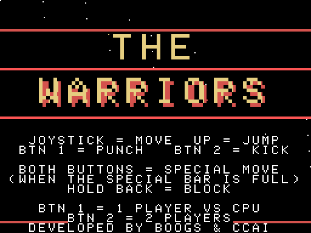
  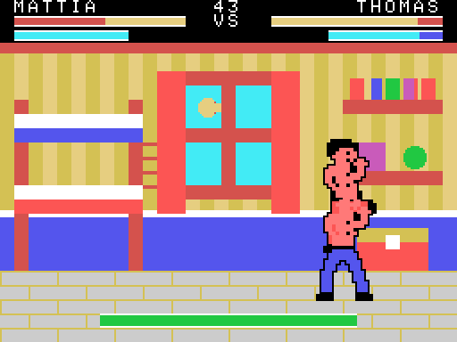

### Breakout

  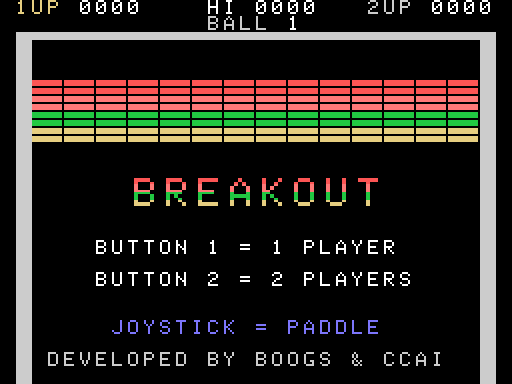
  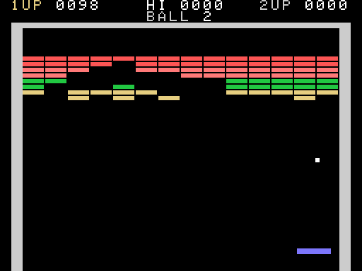

### Asteroids

  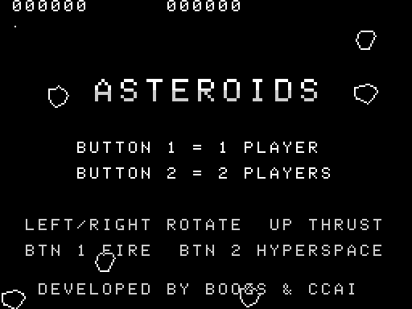
  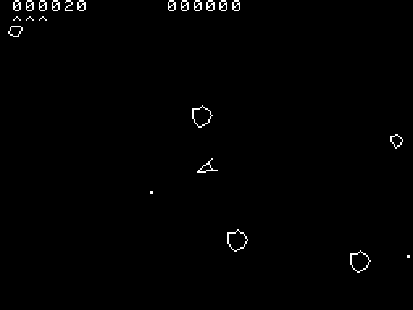

### Space Invaders

  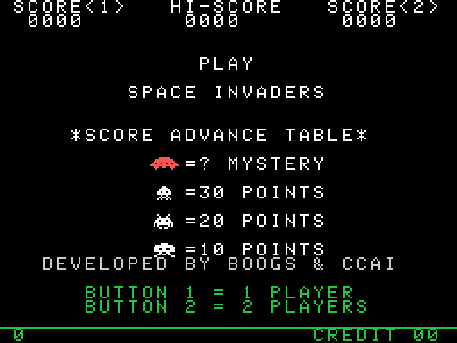
  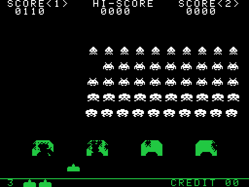

### Warlords

  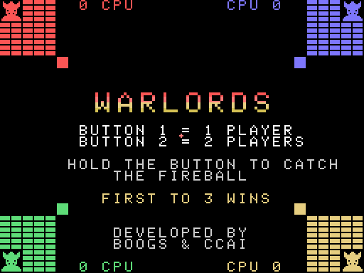
  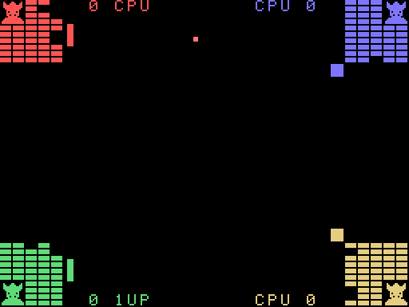

### Defender

  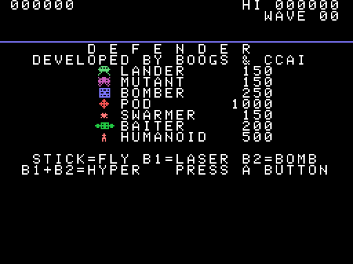
  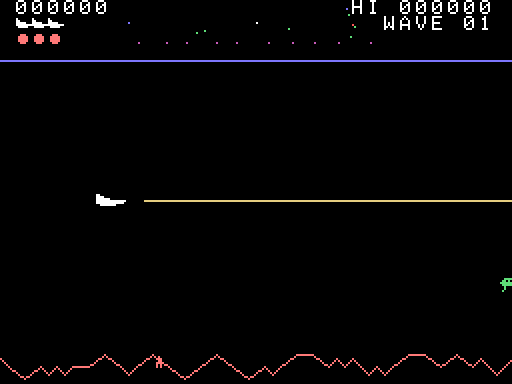

### Radar Scope

  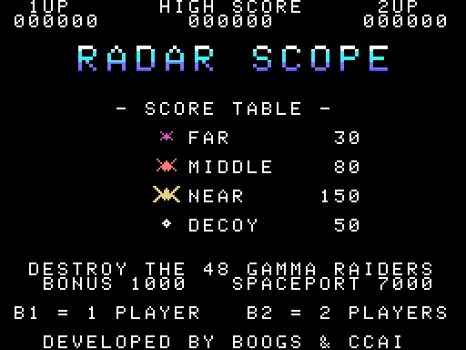
  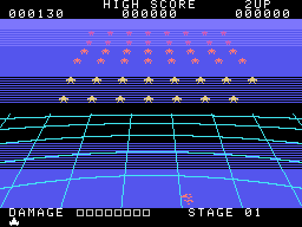

### Space Firebird

  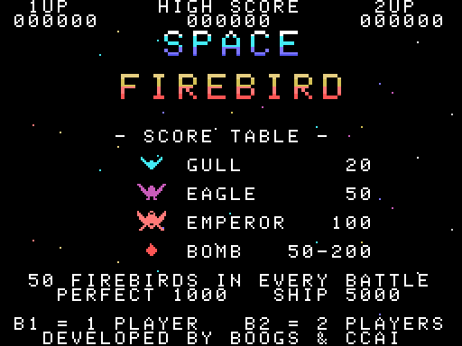
  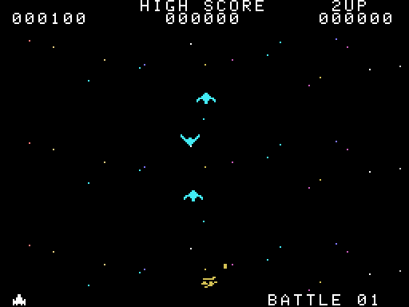

### Moon Cresta

  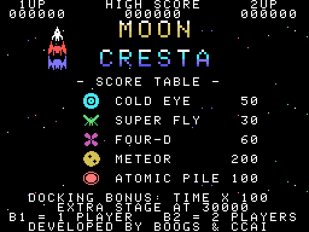
  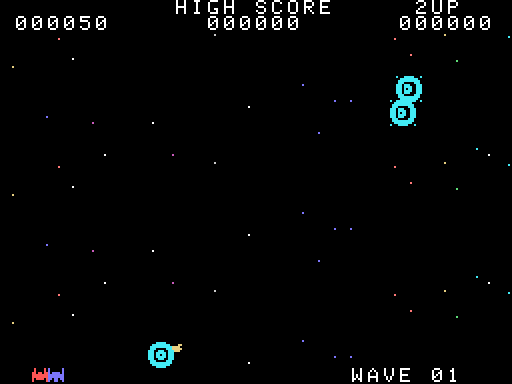

### Stargate

  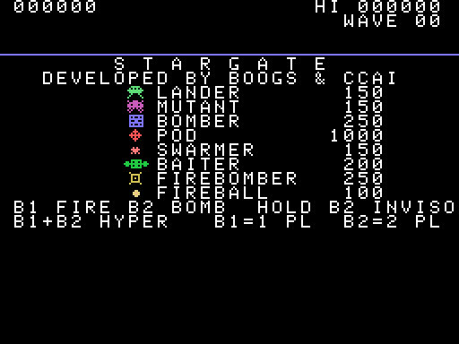
  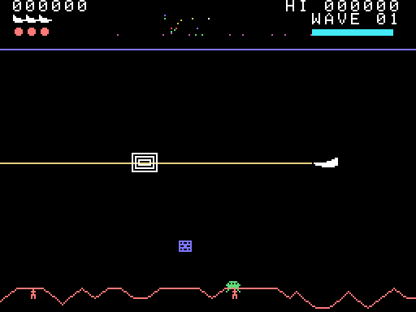

### Gravitar

  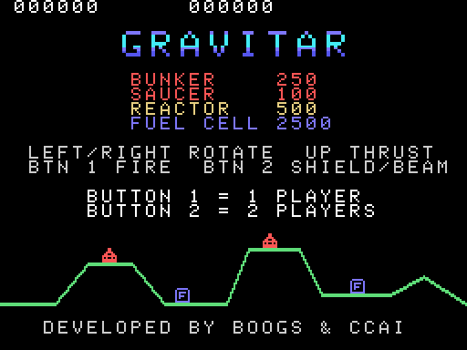
  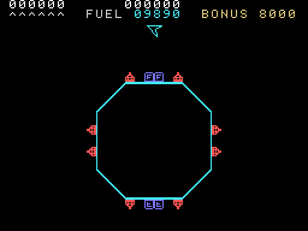

### Quantum

  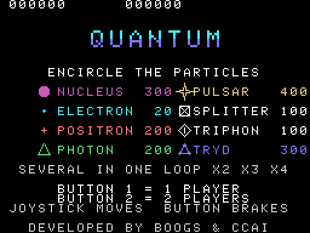
  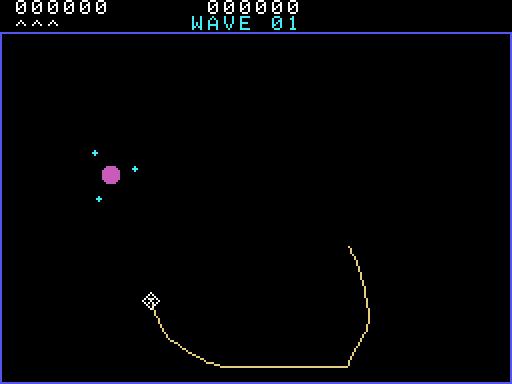

### Joust

  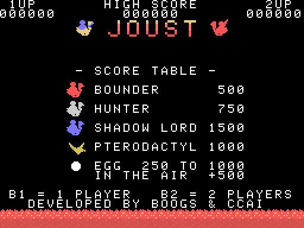
  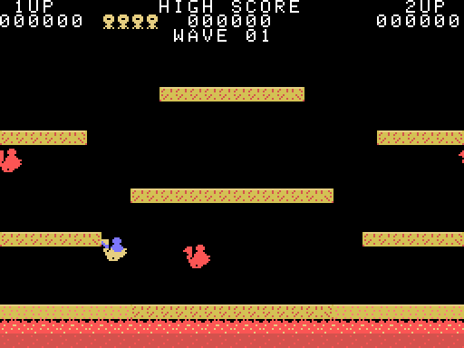

### Exerion

  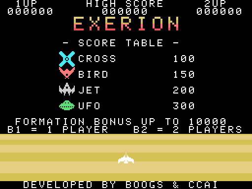
  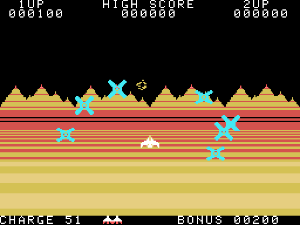

### Bubbles

  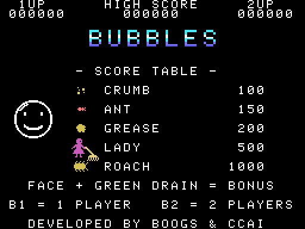
  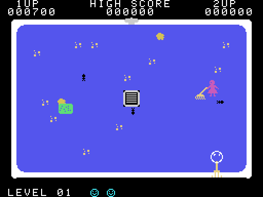

### Times Tables

  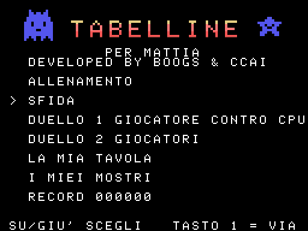
  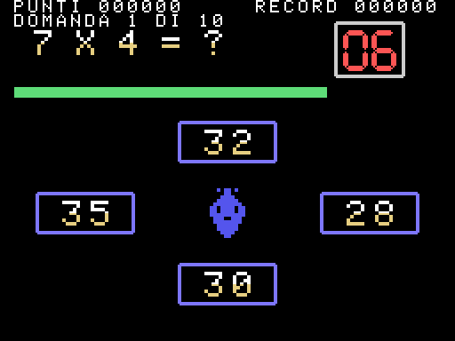

### Robert

  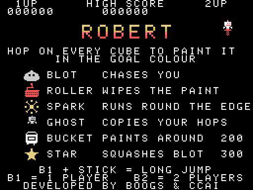
  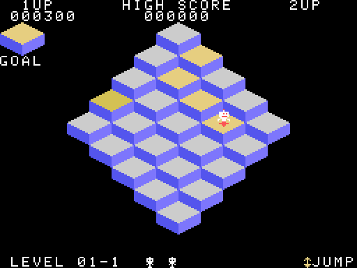

### Cloud Raider

  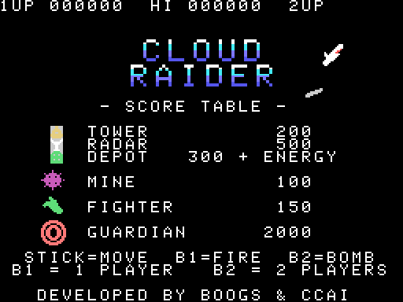
  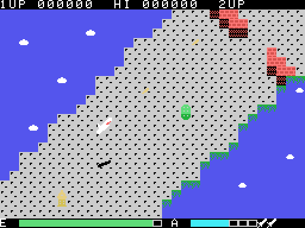

### Crystal Gardens

  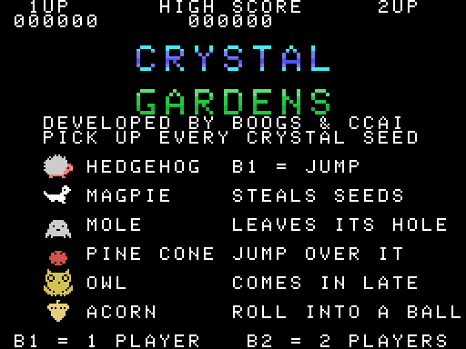
  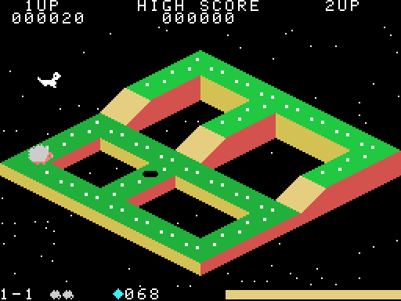

### Special Forces

  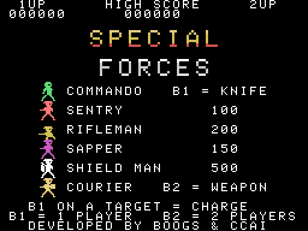
  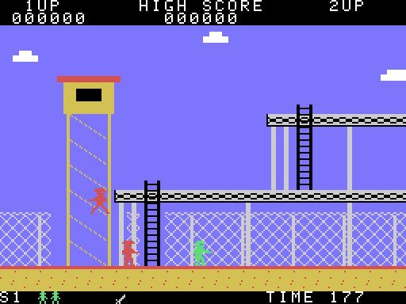

### Core Runner

  
  

### Deep Space Miner

  
  

### Dune Ranger

  
  

### Sky Tug

  
  

### Super Carlo

  
  

### Ghost & Ghust

  
  

### Wormer

  
  

### Sky Squirrel

  
  

### Room

  
  

### Zork I (keyboard and joystick)

  
  

### Zork II (keyboard and joystick)

  
  

### Zork III (keyboard and joystick)

  
  

### Robo Vac

  
  

### Little 6502 Guy

  
  

### Hedge Hop

  
  

### Mole Hole

  
  

### Lighthouse Keeper

  
  

### Paint Duel

  
  

### Lix

  
  

### Cheese Chase

  
  

### Haunted Keep

  
  

### Pastry Panic

  
  

---

## 🔗 Useful Links & Resources

* **BO6502 System:** [65C02-based Modular Computer](https://github.com/Boogs77/BO6502_65C02-based_modular_computer)
* **miniVIC:** [miniVIC 65C02 hardware project](https://github.com/Boogs77/miniVIC_65c02)
* **miniPET:** [The sister project, miniPET 65C02](https://github.com/Boogs77/miniPET_65c02)
* **Video Module:** [BO6502 VDU Reference](https://github.com/Boogs77/BO6502_65C02-based_modular_computer/tree/main/BO6502%20VDU)
* **Audio Module:** [BO6502 AUDIO Reference](https://github.com/Boogs77/BO6502_65C02-based_modular_computer/tree/main/BO6502%20AUDIO)
* **Joystick Module:** [BO6502 JOYSTICK Reference](https://github.com/Boogs77/BO6502_65C02-based_modular_computer/tree/main/BO6502%20JOYSTICK)

---

## ⚖️ Disclaimer

The games in this repository are **fan-made tributes** to classic arcade games. They were written from scratch in 65C02 assembly for the miniVIC as a **non-commercial, educational and demonstration project**, to show what this home-built hardware can do.

* All titles, characters, artwork, sounds and trademarks of the original games (such as *Asteroids*, *Breakout*, *Bubbles*, *Centipede*, *Defender*, *Exerion*, *Gravitar*, *Joust*, *Lunar Lander*, *Missile Command*, *Moon Cresta*, *Quantum*, *Radar Scope*, *Space Firebird*, *Space Invaders*, *Stargate* and *Warlords*) belong to their **respective owners**. Their names are used only to identify the games that inspired these versions.
* This project is **not affiliated with, endorsed or sponsored by** any of the rights holders, and claims no rights over the original games.
* No original program code or ROM data has been used: graphics and sounds are new re-creations made to resemble the originals. The only exception are the Zork I-III story files, which Microsoft released under the MIT License: they are not in this repository but on the SD card, and they run on an interpreter written from scratch. *Zork* is a trademark of its owner.
* No commercial use is intended. If you are a rights holder and have any concern, please [open an issue](https://github.com/Boogs77/miniVIC_games/issues) and the material will be reviewed or removed promptly.

---
*Created by Boogs77 - 2026*
