# miniVIC Games: 65C02 Arcade Collection

A collection of arcade games written in **65C02 assembly** for the **Boogs77-miniVIC**, a compact 8-bit computer built on the modular architecture of the [BO6502 System](https://github.com/Boogs77/BO6502_65C02-based_modular_computer). Every title uses the **TMS9918A** video processor for tile and sprite graphics and two **AY-3-8910** sound chips for stereo music and effects.

> 🚧 The **miniVIC** hardware project (schematics, enclosure, firmware) will be published in its own repository: [miniVIC_65c02](https://github.com/Boogs77/miniVIC_65c02) (coming soon). This repository contains only the game software.

---

## 🎮 Games

| File | Game | Players | Description |
| :--- | :--- | :---: | :--- |
| `tank.asm` | **Tank vs Tank** | 2 | Two tanks on a green battlefield: rotate, move and shoot. First to reach the winning score wins. |
| `1vs1.asm` | **1 vs 1 Basketball** | 2 | One-on-one basketball with shots, jumps, steals and blocks. 2 and 3 point shots, first to 21 wins. |
| `centipede.asm` | **Centipede** | 1 | The classic arcade: shoot the centipede through the mushroom field, watch out for the flea and the spider. Infinite levels. |
| `missile_command.asm` | **Missile Command** | 1–2 | Defend 6 cities from incoming missiles using 3 bases. The second player can join at any time. Full bitmap graphics. |
| `lunar_lander.asm` | **Lunar Lander** | 1 | Land the module softly on the moon pads: smaller pads pay more, plus a leftover fuel bonus. 6 moon maps, 3 landers. Full bitmap graphics. |
| `the_warriors.asm` | **The Warriors** | 2 | Street Fighter style fighting game: 5 warriors, 6 stages, punch, kick, block and special move. Best of 3 rounds. |
| `breakout.asm` | **Breakout** | 1–2 | Atari 1976: 8 rows of bricks in four colours, the ball speeds up and the paddle shrinks when you break through. Two walls, players take turns. |
| `asteroids.asm` | **Asteroids** | 1–2 | Atari 1979: vector-style asteroids that split in three sizes, large and small saucers, hyperspace and the famous heartbeat. Players take turns. |
| `space_invaders.asm` | **Space Invaders** | 1–2 | Taito 1978: 55 invaders that march one at a time, shields that crumble pixel by pixel, three kinds of bombs, mystery saucer and the four-note march. Colour bands of the cabinet overlay. |
| `warlords.asm` | **Warlords** | 1–2 | Atari 1980: four castles, shields on an L-shaped track, catch and throw the fireball. 1 or 2 players against the computer castles; first to 3 rounds wins. |

Each source file starts with a header describing controls, rules and technical notes.

> ℹ️ These games are non-commercial fan-made tributes to the original arcade games: see the **Disclaimer** at the end of this page.

---

## 🧠 Hardware Requirements

The games run on the miniVIC and rely on the following BO6502 modules:

### 📺 Video (TMS9918A)
* **Mode:** Graphics II (256x192, 32 sprites), bitmap mode for Missile Command.
* **Addressing:** VDP register port at **$B001**.
* **Reference:** [BO6502 VDU](https://github.com/Boogs77/BO6502_65C02-based_modular_computer/tree/main/BO6502%20VDU).

### 🔊 Audio (2 x AY-3-8910)
* **Right channel:** latch **$D380**, write **$D381**.
* **Left channel:** latch **$D384**, write **$D385**.
* **Reference:** [BO6502 AUDIO](https://github.com/Boogs77/BO6502_65C02-based_modular_computer/tree/main/BO6502%20AUDIO).

### 🕹️ Joysticks (W65C22 VIA)
* **Player 1:** PORTA at **$D581**.
* **Player 2:** PORTB at **$D580**.
* **Bits:** UP, DOWN, LEFT, RIGHT, button 1 (bit4), button 2 (bit5).
* **Reference:** [BO6502 JOYSTICK](https://github.com/Boogs77/BO6502_65C02-based_modular_computer/tree/main/BO6502%20JOYSTICK).

---

## 💻 Program Structure

All games share the same layout:
* **Load address:** programs are assembled at **$1000**.
* **NMI trampoline:** at **$0FD0**, called by the BIOS `NMI_HANDLER` with `JSR $0FD0` on every VDP vertical blank (60 Hz).
* **Frame update:** the NMI copies the sprite attribute table (SAT) buffer to the VDP and runs the sound engine, while the main loop handles game logic.
* **Graphics data:** screens, patterns and sprites are stored as generated tables at the bottom of each file.

---

## 🛠️ Build

The games are assembled with **vasm6502_oldstyle** (`-Fbin -dotdir -c02`). Ready-to-load binaries are in the [`bin`](bin) folder; each one starts at **$0FD0** (NMI trampoline) followed by the program at **$1000**.

To rebuild them:
1. Write the full path of `vasm6502_oldstyle.exe` in a file named `vasm.path` (or set the `VASM` environment variable).
2. Run `build.bat` to assemble all games, or `build.bat tank.asm` for a single one. In VS Code, press **Ctrl+Shift+B** to build the open file.

The script assembles every file into `bin/`, optionally copies the sources and binaries to the local folder written in `copy.path`, runs each game in the emulator to update its screenshots, then commits and pushes the updated binaries and screenshots. Use `build.ps1 -NoPublish` to build without publishing.

### 🖥️ Emulator & Screenshots
The [`tools`](tools) folder contains a small **miniVIC emulator** written in Node.js (no dependencies): W65C02S CPU, TMS9918A video with sprites, VDP interrupt on NMI and the two joysticks (no audio).
* `node tools/screenshots.js` runs every game and saves its screenshots in [`screenshots`](screenshots).
* `tools/screenshots.json` defines, for each game, the input sequence (wait, button presses, random play) and when to take each picture.

---

## 🖼️ Screenshots

Captured with the miniVIC emulator in [`tools`](tools): title screen and gameplay.

### Tank vs Tank

  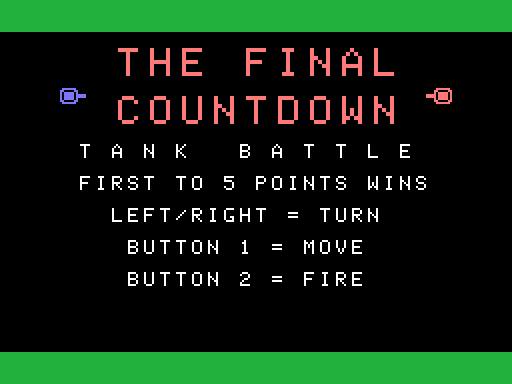
  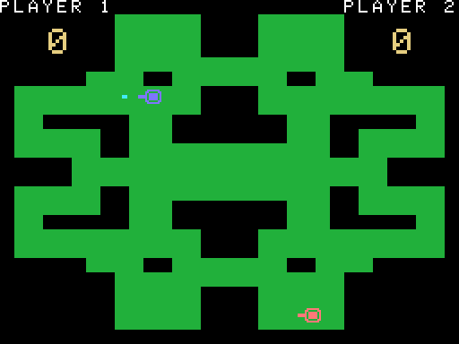

### 1 vs 1 Basketball

  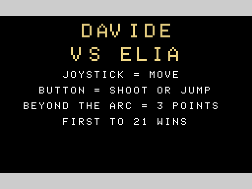
  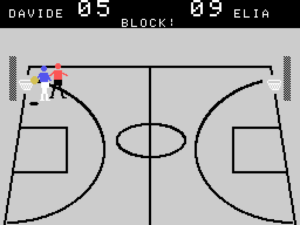

### Centipede

  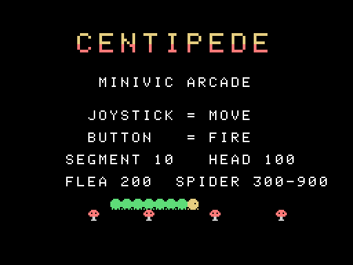
  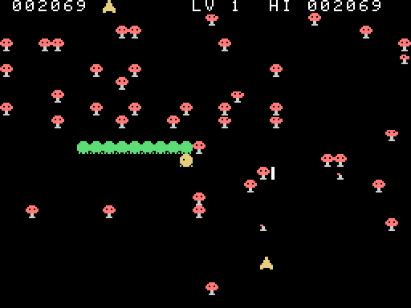

### Missile Command

  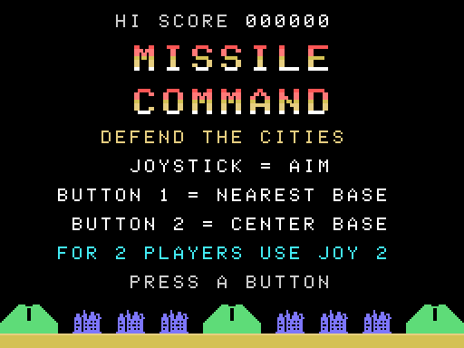
  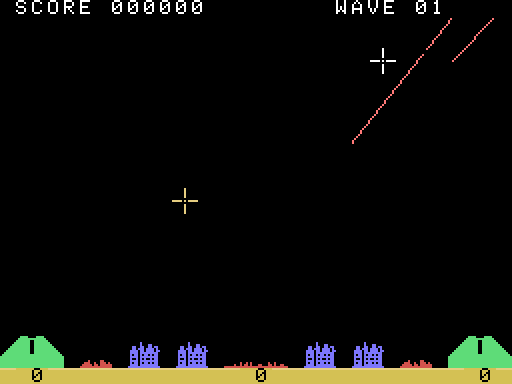

### Lunar Lander

  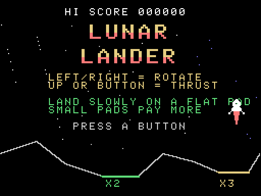
  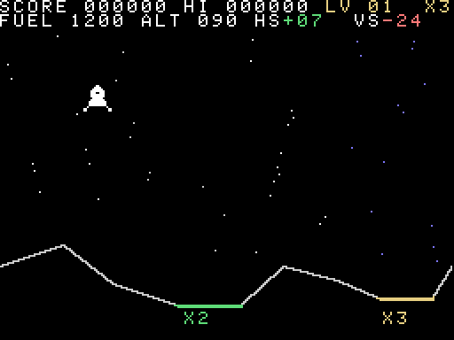

### The Warriors

  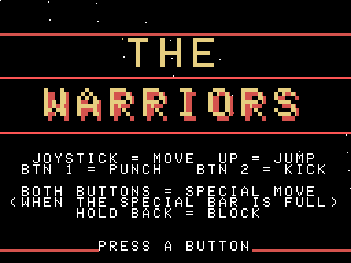
  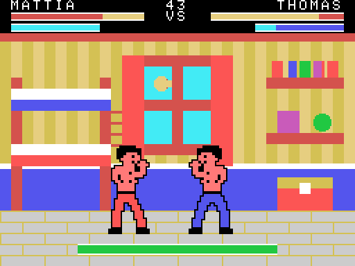

### Breakout

  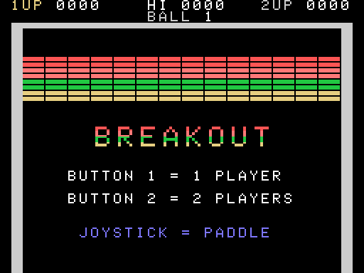
  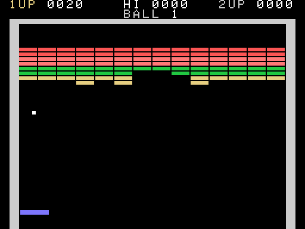

### Asteroids

  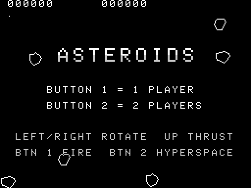
  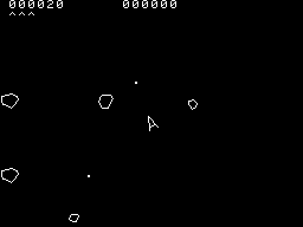

### Space Invaders

  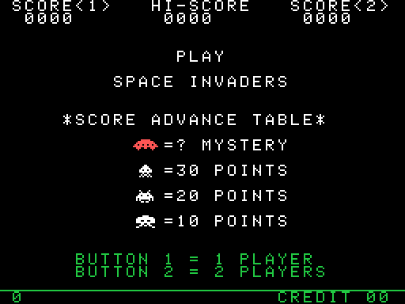
  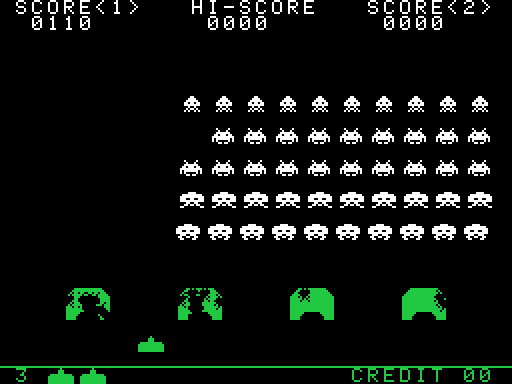

### Warlords

  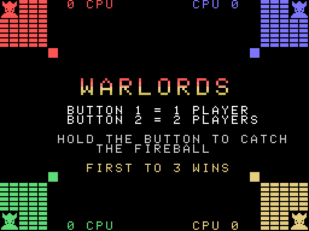
  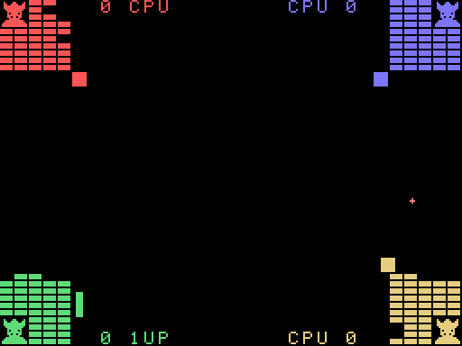

---

## 🔗 Useful Links & Resources

* **BO6502 System:** [65C02-based Modular Computer](https://github.com/Boogs77/BO6502_65C02-based_modular_computer)
* **miniVIC:** [miniVIC 65C02 hardware project](https://github.com/Boogs77/miniVIC_65c02) (coming soon)
* **miniPET:** [The sister project, miniPET 65C02](https://github.com/Boogs77/miniPET_65c02)
* **Video Module:** [BO6502 VDU Reference](https://github.com/Boogs77/BO6502_65C02-based_modular_computer/tree/main/BO6502%20VDU)
* **Audio Module:** [BO6502 AUDIO Reference](https://github.com/Boogs77/BO6502_65C02-based_modular_computer/tree/main/BO6502%20AUDIO)
* **Joystick Module:** [BO6502 JOYSTICK Reference](https://github.com/Boogs77/BO6502_65C02-based_modular_computer/tree/main/BO6502%20JOYSTICK)

---

## ⚖️ Disclaimer

The games in this repository are **fan-made tributes** to classic arcade games. They were written from scratch in 65C02 assembly for the miniVIC as a **non-commercial, educational and demonstration project**, to show what this home-built hardware can do.

* All titles, characters, artwork, sounds and trademarks of the original games (such as *Asteroids*, *Breakout*, *Centipede*, *Lunar Lander*, *Missile Command*, *Space Invaders* and *Warlords*) belong to their **respective owners**. Their names are used only to identify the games that inspired these versions.
* This project is **not affiliated with, endorsed or sponsored by** any of the rights holders, and claims no rights over the original games.
* No original program code or ROM data has been used: graphics and sounds are new re-creations made to resemble the originals.
* No commercial use is intended. If you are a rights holder and have any concern, please [open an issue](https://github.com/Boogs77/miniVIC_games/issues) and the material will be reviewed or removed promptly.

---
*Created by Boogs77 - 2026*
